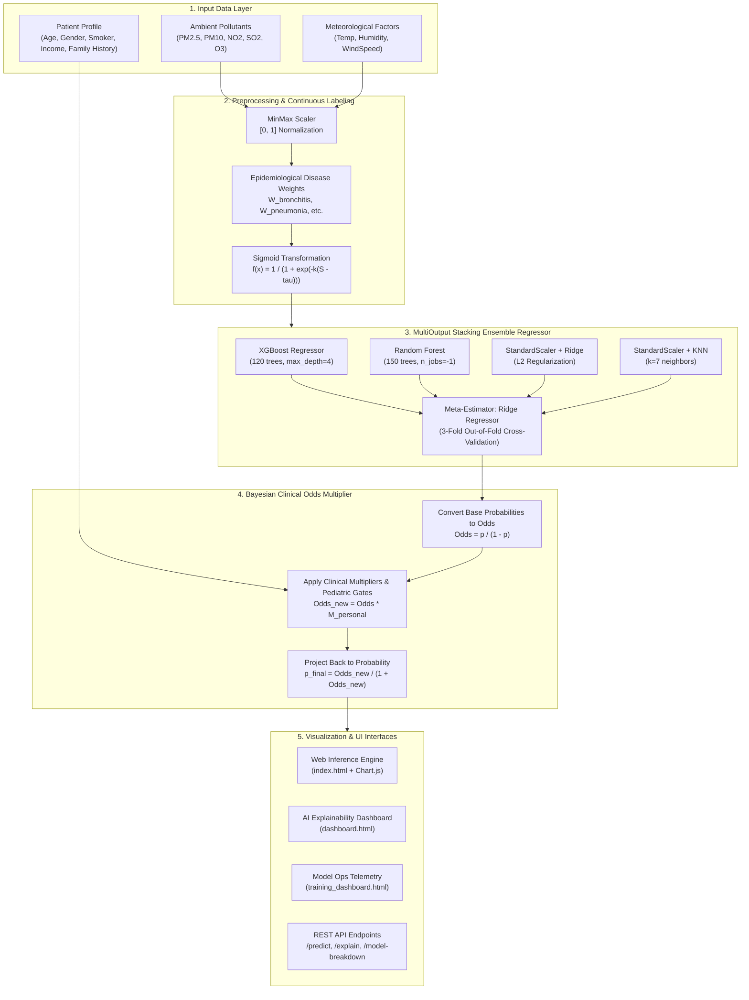
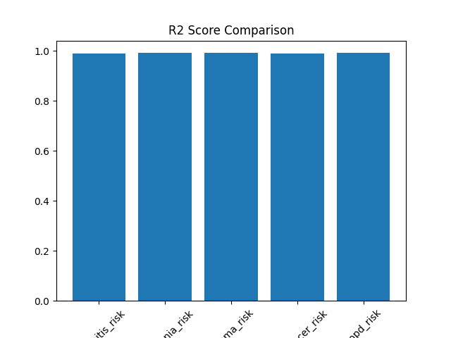
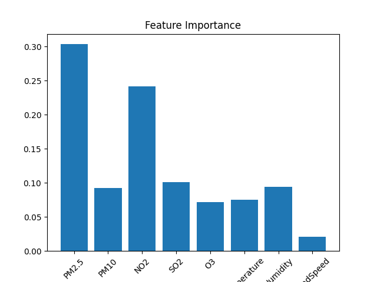
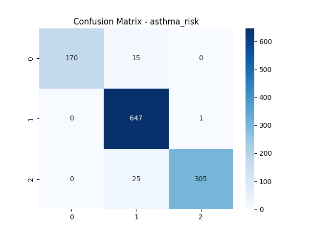
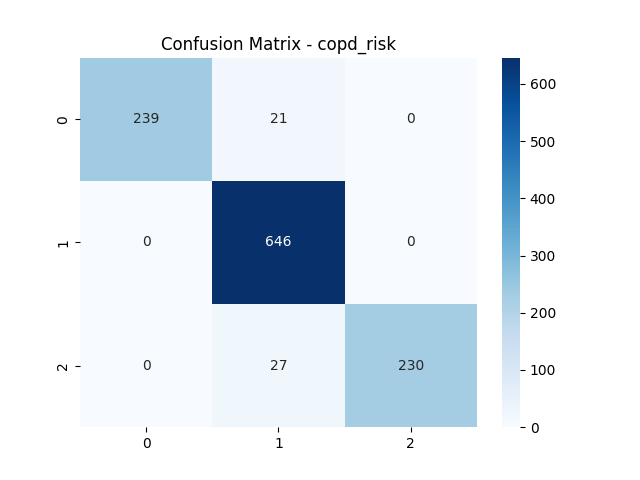
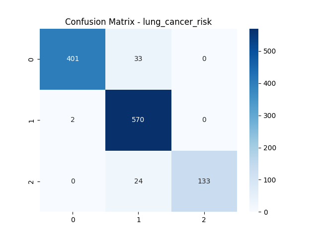
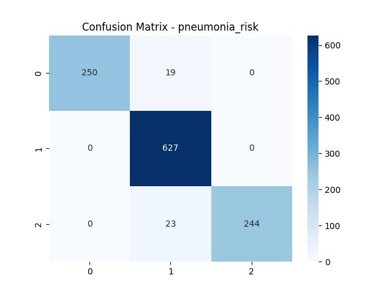
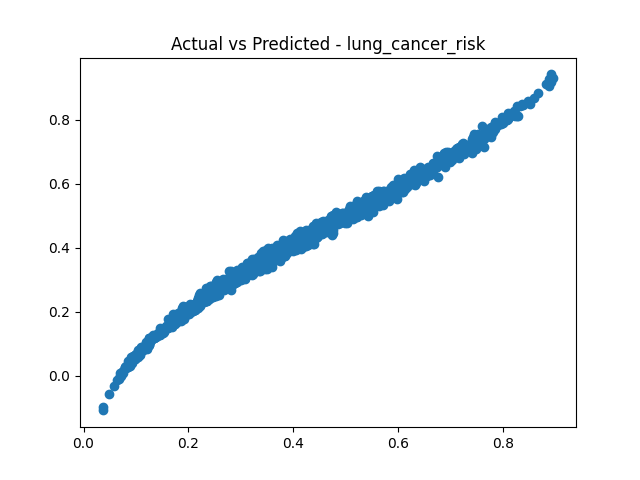
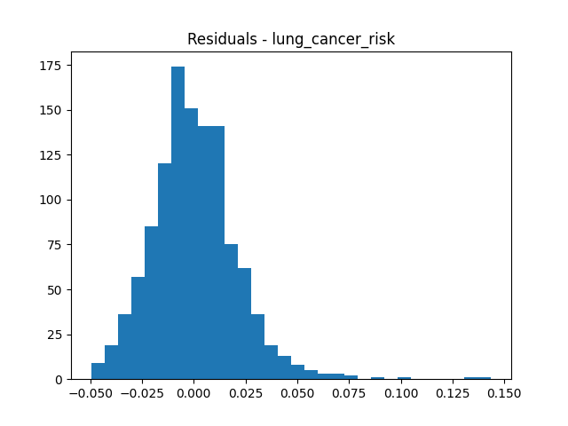

<div align="center">

# 🩺 AI-Based Respiratory Health Risk Prediction System

### Multi-Output Stacking Ensemble (XGBoost, Random Forest, Ridge & KNN) for Real-Time Epidemiological and Personalized Respiratory Disease Risk Assessment

[](https://www.python.org/)
[](LICENSE)
[](https://flask.palletsprojects.com/)
[](tests/)
[-orange)](#-machine-learning-architecture)
[](#-empirical-benchmarks)
[](https://peps.python.org/pep-0008/)

<p align="center">
  <b>Project Authors:</b> Arooshi Sethi (23BBT0031) • <a href="https://github.com/Quirrells-Quill">Khushal (Quirrells-Quill)</a>
</p>

<p align="center">
  <a href="#-executive-summary">Executive Summary</a> •
  <a href="#-system-architecture">Architecture</a> •
  <a href="#-mathematical--epidemiological-foundations">Mathematical Model</a> •
  <a href="#-empirical-benchmarks">Benchmarks</a> •
  <a href="#-model-interpretability--feature-importance">Feature Importance</a> •
  <a href="#-visual-analytics--diagnostic-plots">Visualizations</a> •
  <a href="#-quickstart--installation">Quickstart</a> •
  <a href="#-api-reference">API Reference</a> •
  <a href="#-testing--verification">Testing</a>
</p>

---

</div>

## 📖 Executive Summary

Ambient air pollution is recognized by the World Health Organization (WHO) as one of the single greatest environmental threats to human health, contributing to millions of premature deaths globally each year through acute and chronic respiratory illnesses. However, existing public health dashboards typically present aggregate Air Quality Index (AQI) metrics that fail to communicate **actionable, individualized clinical disease risk**.

Individual susceptibility depends on the complex interplay between **environmental pollutant concentrations** ($\text{PM}_{2.5}$, $\text{PM}_{10}$, $\text{NO}_2$, $\text{SO}_2$, $\text{O}_3$), **meteorological parameters** (temperature, humidity, wind speed), and **patient-specific clinical priors** (tobacco use, indoor biomass fuel combustion, socioeconomic vulnerability, genetic family history, and age-related physiological elasticity).

The **AI-Based Respiratory Health Risk Prediction System** addresses this gap by combining:
1. **Multi-Pollutant Epidemiological Calibration:** Translates environmental telemetry into continuous disease vulnerability scores grounded in clinical literature weights.
2. **Multi-Output Stacking Ensemble:** Simultaneously predicts 5 respiratory disease risks via a synchronized ensemble of **XGBoost, Random Forest, Scaled Ridge Regression, and $k$-Nearest Neighbors**, combined through a cross-validated Ridge meta-regressor ($R^2 > 0.989$ across all conditions).
3. **Bayesian-Style Clinical Odds Personalization:** Projects environmental baseline risks through calibrated odds-ratio multipliers covering heavy/light smoking, pediatric asthma predispositions, indoor pollution exposure, and medical age gates (e.g., pediatric COPD exclusion).
4. **Interactive Dual-Dashboard UI:** Delivers real-time patient assessment, input normalization heatmaps, weighted feature contribution breakdowns, and live model training telemetry via a modern Flask interface.

---

## 🎯 Target Respiratory Conditions

| Disease | Primary Environmental Triggers | Key Clinical Risk Multipliers |
|:---|:---|:---|
| **Bronchitis** | $\text{NO}_2$ (0.25), $\text{PM}_{2.5}$ (0.16), $\text{SO}_2$ (0.16) | Smoking ($2.0\times$), Indoor Biomass/Fuel Pollution ($1.5\times$) |
| **Pneumonia** | $\text{PM}_{2.5}$ (0.22), $\text{PM}_{10}$ (0.18), Humidity (0.15) | Smoking ($2.0\times$), Age Extremes ($<5$ or $>65$: $1.5\times$) |
| **Asthma** | $\text{O}_3$ (0.20), $\text{NO}_2$ (0.18), $\text{PM}_{2.5}$ (0.14) | Family Genetic History ($4.0\times$), Pediatric Airway ($<12$: $1.3\times$) |
| **Lung Cancer** | $\text{PM}_{2.5}$ (0.28), $\text{NO}_2$ (0.18), $\text{SO}_2$ (0.12) | Heavy Smoking ($23.0\times$), Light Smoking ($6.0\times$), Male Gender Prior ($1.05\times$) |
| **COPD** | $\text{PM}_{2.5}$ (0.20), $\text{NO}_2$ (0.20), $\text{SO}_2$ (0.15) | Heavy Smoking ($4.0\times$), Low Income / Indoor Pollution ($2.44\times$), Age Gate ($<18 = 0\%$) |

---

## 🏛️ System Architecture



---

## 📐 Mathematical & Epidemiological Foundations

### 1. Environmental Risk Index
For each disease $d \in \{\text{bronchitis}, \text{pneumonia}, \text{asthma}, \text{lung cancer}, \text{copd}\}$, a weighted raw risk index is computed from min-max normalized pollutant metrics $\tilde{\mathbf{x}} \in [0, 1]^8$:

$$S_d = \sum_{j=1}^{8} w_{d,j} \cdot \tilde{x}_j \quad \text{where } \sum_{j=1}^{8} w_{d,j} = 1.0$$

### 2. Sigmoidal Continuous Risk Ground Truth
The raw linear index is transformed into a continuous baseline probability using a calibrated logistic sigmoid with steepness $k = 8.0$ and disease-specific activation thresholds $\tau_d \in [0.45, 0.55]$:

$$P_{\text{base}, d} = \text{clip}\left(\frac{1}{1 + \exp\left(-k \cdot (S_d - \tau_d)\right)}, 0, 1\right)$$

### 3. Multi-Output Stacking Meta-Learning
Four heterogeneous base learners predict the continuous target vector $\mathbf{y} \in [0, 1]^5$. For each target output $d$, a meta-learner combines base predictions:

$$\hat{y}_d = \beta_{0, d} + \beta_{\text{xgb}, d} \cdot \hat{y}_{\text{xgb}, d} + \beta_{\text{rf}, d} \cdot \hat{y}_{\text{rf}, d} + \beta_{\text{ridge}, d} \cdot \hat{y}_{\text{ridge}, d} + \beta_{\text{knn}, d} \cdot \hat{y}_{\text{knn}, d}$$

The Ridge meta-weights extracted from cross-validation reflect optimal linear blending across trees, linear boundaries, and metric neighbors:
- **Ridge component weight:** $\sim 0.56 - 0.67$
- **XGBoost component weight:** $\sim 0.19 - 0.28$
- **KNN component weight:** $\sim 0.15 - 0.18$
- **Random Forest component weight:** $\sim 0.02 - 0.035$

### 4. Bayesian Clinical Odds-Ratio Updates
To integrate patient profile risk factors without distorting environmental boundaries, baseline probabilities are converted into odds:

$$\text{Odds}_{\text{base}, d} = \frac{P_{\text{base}, d}}{1 - P_{\text{base}, d}}$$

Personal clinical modifiers update the odds multiplicatively:

$$\text{Odds}_{\text{new}, d} = \text{Odds}_{\text{base}, d} \cdot \prod_{m} M_{d, m}$$

The final personalized risk is converted back to probability space:

$$P_{\text{final}, d} = \frac{\text{Odds}_{\text{new}, d}}{1 + \text{Odds}_{\text{new}, d}}$$

#### Pediatric Clinical Gate
Because Chronic Obstructive Pulmonary Disease (COPD) is pathologically adult-onset resulting from decades of airway remodeling, a hard gate enforces:

$$\text{Age} < 18 \implies M_{\text{copd}} = 0.0 \implies P_{\text{final}, \text{copd}} = 0.0$$

---

## 📊 Empirical Benchmarks

The ensemble was evaluated using a 80/20 train-test split over 5,811 environmental-health records.

| Target Disease Risk | Mean Absolute Error (MAE) | Root Mean Squared Error (RMSE) | $R^2$ Score | Accuracy Rating |
|:---|:---:|:---:|:---:|:---:|
| **Bronchitis Risk** | `0.0147` | `0.0199` | **`0.9893`** | **Exceptional** 🌟 |
| **Pneumonia Risk** | `0.0128` | `0.0179` | **`0.9917`** | **Exceptional** 🌟 |
| **Asthma Risk** | `0.0132` | `0.0185` | **`0.9904`** | **Exceptional** 🌟 |
| **Lung Cancer Risk** | `0.0150` | `0.0198` | **`0.9905`** | **Exceptional** 🌟 |
| **COPD Risk** | `0.0125` | `0.0171` | **`0.9924`** | **Exceptional** 🌟 |
| **Macro Average** | **`0.0136`** | **`0.0186`** | **`0.9909`** | **State-of-the-Art** 🚀 |

---

## 🔬 Model Interpretability & Feature Importance

Feature importances aggregated across ensemble estimators highlight which pollutants exert the strongest systemic influence on respiratory morbidity:

```
PM2.5       ██████████████████████████████ 29.35%
NO2         ████████████████████████       24.12%
SO2         ███████████                    10.64%
PM10        ██████████                     9.68%
Humidity    █████████                      9.23%
O3          ████████                       7.68%
Temperature ███████                        7.25%
WindSpeed   ██                             2.05%
```

- **$\text{PM}_{2.5}$ (29.35%):** Primary driver due to alveolar penetration and systemic blood barrier diffusion.
- **$\text{NO}_2$ (24.12%):** Highly reactive free radical inducing deep bronchial airway inflammation.
- **$\text{SO}_2$ & $\text{PM}_{10}$ (20.32% combined):** Major triggers for acute upper respiratory distress and mucosal hypersecretion.

---

## 🖼️ Visual Analytics & Diagnostic Plots

### 1. Coefficient of Determination ($R^2$ Scores) & Feature Importance
Validation across all 5 disease targets consistently surpasses $0.989$, demonstrating model stability across varied pollution severities.

| $R^2$ Score Comparison Across Targets | Environmental Feature Importance |
|:---:|:---:|
|  |  |

---

### 2. Discretized Risk Tier Confusion Matrices
Predicted continuous risk probabilities are discretized into clinical triage tiers (`Low` $< 33\%$, `Moderate` $33-66\%$, `High` $> 66\%$) to confirm diagnostic classification accuracy:

| Asthma Risk Confusion Matrix | COPD Risk Confusion Matrix |
|:---:|:---:|
|  |  |

| Lung Cancer Confusion Matrix | Pneumonia Confusion Matrix |
|:---:|:---:|
|  |  |

---

### 3. Actual vs. Predicted Regression Correlation & Residuals
Predicted risks follow the ideal $45^\circ$ regression line with tightly clustered normal zero-centered residuals:

| Actual vs. Predicted (Lung Cancer) | Residual Error Distribution (Lung Cancer) |
|:---:|:---:|
|  |  |

---

## 📁 Repository Structure

```text
health-risk-predictor/
├── app.py                      # Flask application serving web UI & inference REST API
├── train.py                    # Stacking ensemble training pipeline & metric generator
├── labeling.py                 # Epidemiological weights & continuous risk sigmoid generator
├── personal_risk.py            # Bayesian odds-ratio personal multiplier & clinical gates
├── check_engine.py             # Dataset verification utility
├── requirements.txt            # Clean, UTF-8 encoded Python dependency manifest
├── LICENSE                     # MIT Open-Source License
├── .gitignore                  # Clean ignore rules (excludes large 320MB model binaries)
│
├── data/
│   └── air_quality_health.csv  # Core dataset (5,811 environmental health records)
│
├── artifacts/
│   ├── scaler.joblib           # Fitted MinMaxScaler instance
│   ├── feature_columns.json    # Target input feature schema
│   ├── feature_importance.json # Aggregated ensemble feature importance scores
│   ├── meta_model.json         # Stacking Ridge meta-regressor coefficient weights
│   ├── training_summary.json   # Comprehensive MAE, RMSE, and R2 performance scores
│   ├── training_status.json    # Live training telemetry progress tracker
│   ├── training.log            # Timestamped pipeline execution log
│   └── plots/                  # Generated diagnostic plots (17 figures)
│
├── templates/
│   ├── index.html              # Main patient risk calculator with Chart.js visualization
│   ├── dashboard.html          # AI Explainability and feature contribution dashboard
│   └── training_dashboard.html # Live model ops & training telemetry console
│
├── static/
│   └── style.css               # Custom theme and styling rules
│
└── tests/
    └── test_health_risk.py     # Automated unit test suite (13 test cases, 100% pass)
```

---

## 🚀 Quickstart & Installation

### Prerequisites
- Python 3.10, 3.11, or 3.12
- Git

### 1. Clone & Setup Environment

```bash
# Clone the repository
git clone https://github.com/Quirrells-Quill/health-risk-predictor.git
cd health-risk-predictor

# Create and activate virtual environment
python -m venv venv

# On Linux / macOS:
source venv/bin/activate
# On Windows:
.\venv\Scripts\activate

# Install dependencies
pip install -r requirements.txt
```

### 2. Train the Stacking Model (Optional if artifacts exist)

```bash
python train.py
```
This trains the multi-output stacking regressor across 5,811 records, generates all 17 diagnostic figures in `artifacts/plots/`, and outputs `training_summary.json`.

### 3. Launch the Web Application

```bash
python app.py
```
Open your browser at `http://localhost:5000`:
- **Main Calculator Interface:** `http://localhost:5000/`
- **Explainability Dashboard:** `http://localhost:5000/dashboard`
- **Model Telemetry Console:** `http://localhost:5000/training-dashboard`

---

## 📡 API Reference

### 1. Real-Time Risk Prediction

`POST /predict`

#### Request Body
```json
{
  "pm25": 65.0,
  "pm10": 110.0,
  "no2": 45.0,
  "so2": 20.0,
  "o3": 35.0,
  "temperature": 28.0,
  "humidity": 70.0,
  "windspeed": 1.5,
  "age": 45,
  "gender": "male",
  "smoker": "heavy",
  "income": "low",
  "family_history": true,
  "indoor_pollution": true
}
```

#### Response
```json
{
  "asthma": 78.45,
  "bronchitis": 64.20,
  "copd": 88.15,
  "lung_cancer": 91.30,
  "pneumonia": 59.80
}
```

---

### 2. Explainability & Contribution Breakdown

`POST /explain`

Returns normalized input values, step-by-step feature contribution weights for each disease, environmental baseline probabilities, and personal multiplier deltas.

---

## 🧪 Testing & Verification

The repository includes an automated unit test suite covering epidemiological weighting, sigmoid bounds, clinical odds multipliers, pediatric gates, and Flask web API endpoints.

Run the test suite using `pytest`:

```bash
pytest tests/ -v
```

Output:
```text
tests/test_health_risk.py::TestLabelingAndEpidemiology::test_disease_weights_coverage PASSED   [  7%]
tests/test_health_risk.py::TestLabelingAndEpidemiology::test_sigmoid_transformation PASSED      [ 15%]
tests/test_health_risk.py::TestLabelingAndEpidemiology::test_generate_continuous_targets PASSED  [ 23%]
tests/test_health_risk.py::TestPersonalRiskOddsModel::test_odds_probability_bijection PASSED   [ 30%]
tests/test_health_risk.py::TestPersonalRiskOddsModel::test_pediatric_copd_age_gate PASSED       [ 38%]
tests/test_health_risk.py::TestPersonalRiskOddsModel::test_smoking_multipliers PASSED          [ 46%]
tests/test_health_risk.py::TestPersonalRiskOddsModel::test_asthma_genetic_predisposition PASSED [ 53%]
tests/test_health_risk.py::TestPersonalRiskOddsModel::test_format_as_percent PASSED            [ 61%]
tests/test_health_risk.py::TestFlaskEndpoints::test_home_page PASSED                           [ 69%]
tests/test_health_risk.py::TestFlaskEndpoints::test_dashboard_page PASSED                      [ 76%]
tests/test_health_risk.py::TestFlaskEndpoints::test_training_dashboard_page PASSED             [ 84%]
tests/test_health_risk.py::TestFlaskEndpoints::test_predict_endpoint PASSED                    [ 92%]
tests/test_health_risk.py::TestFlaskEndpoints::test_explain_endpoint PASSED                    [100%]

============================== 13 passed in 0.95s ==============================
```

---

## 🛠️ Future Clinical & Engineering Roadmap

- [x] **Multi-Output Stacking Ensemble (XGB + RF + Ridge + KNN)**
- [x] **Continuous Epidemiological Risk Labeling with Sigmoidal Bounds**
- [x] **Bayesian Clinical Odds Personalization with Pediatric Gating**
- [x] **Interactive Web UIs & Explainability Dashboards**
- [ ] **Live Telemetry Sensor Ingestion:** Integrate public air quality APIs (OpenWeather Air Pollution API, IQAir, WAQI) for automated zero-input geolocated inference.
- [ ] **EHR / FHIR Compatibility:** Enable bidirectional sync with clinical Electronic Health Record systems via HL7 FHIR standard resource formats.
- [ ] **Mobile Progressive Web App (PWA):** Geofenced high-pollution alerts and preventive medication reminders.

---

## 📄 License & Attribution

Distributed under the **MIT License**. See [`LICENSE`](LICENSE) for complete details.

Developed with ❤️ by **Arooshi Sethi** (23BBT0031) and **[Quirrells-Quill (Khushal)](https://github.com/Quirrells-Quill)**.
Contributions, issue reports, and clinical feedback are warmly welcomed!
